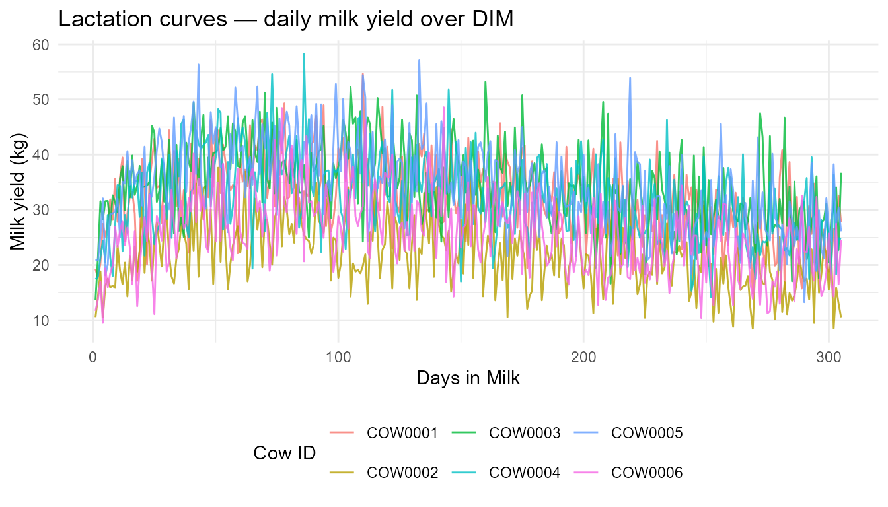
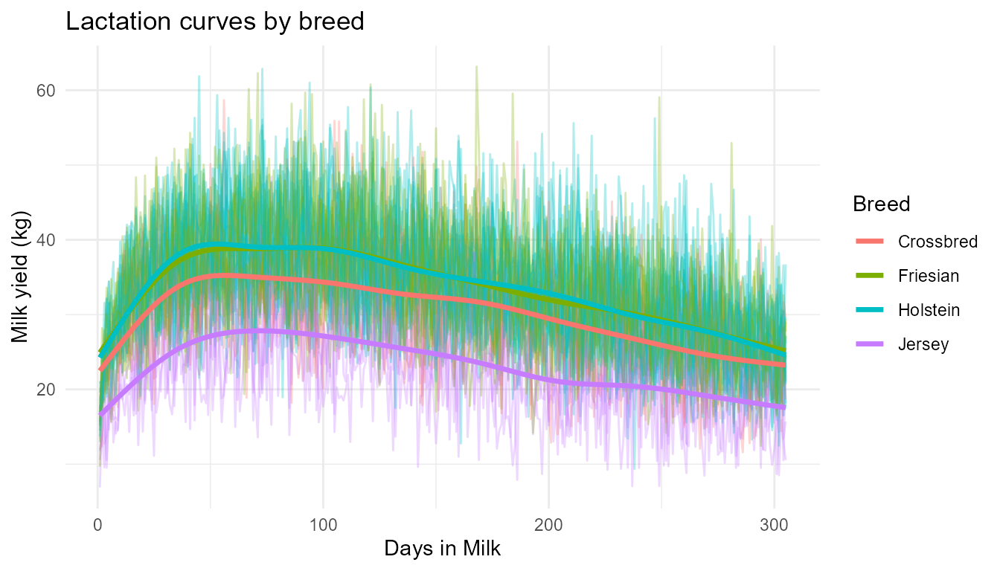
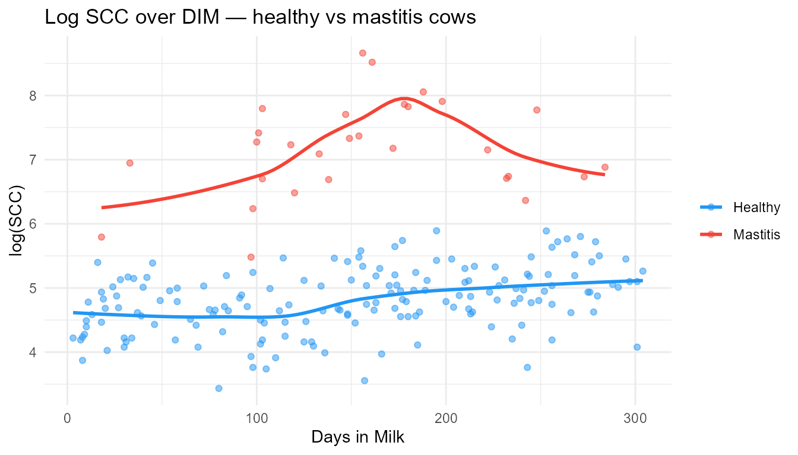
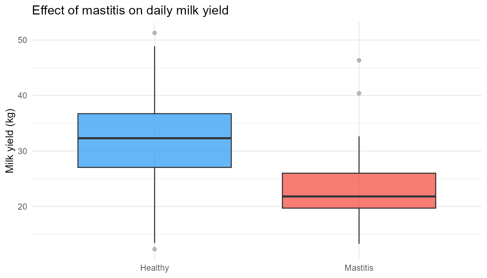
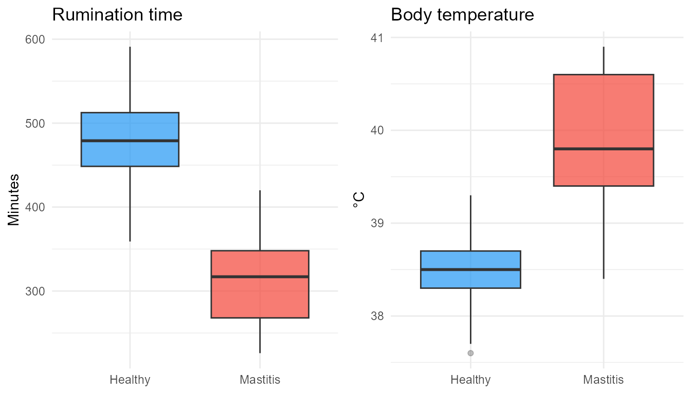
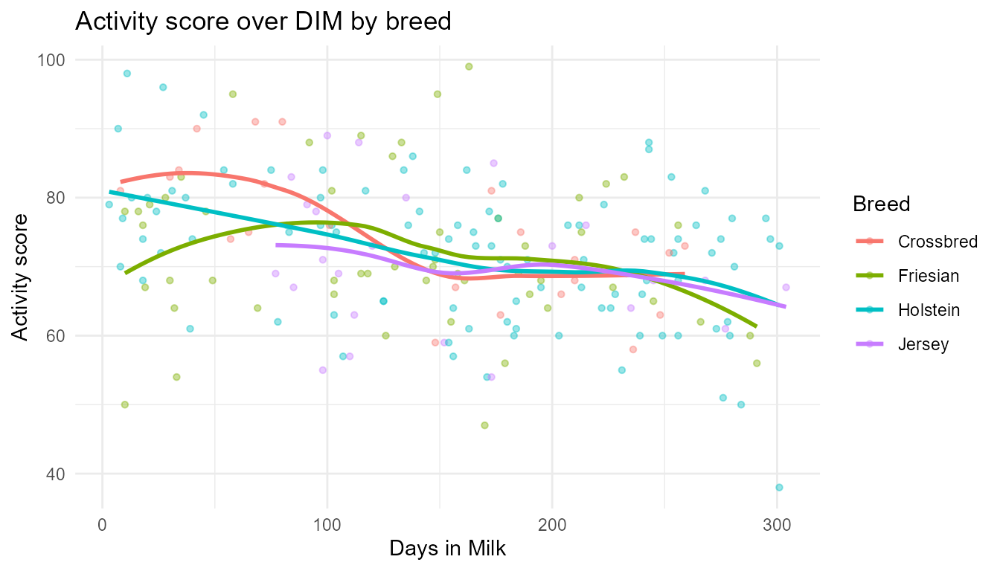
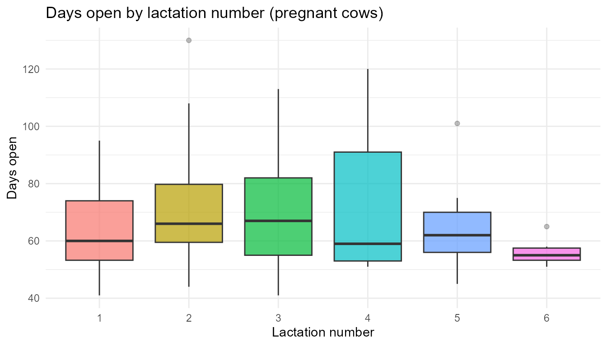
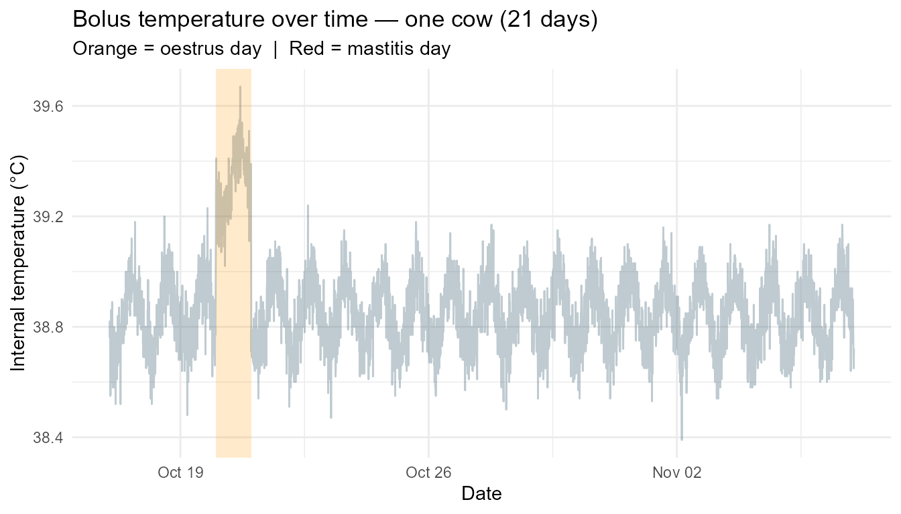
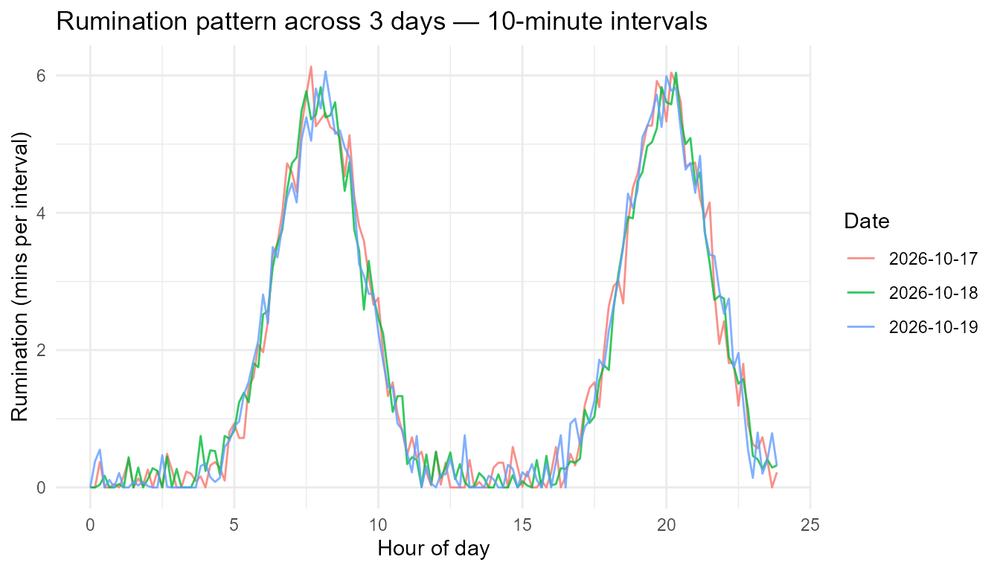
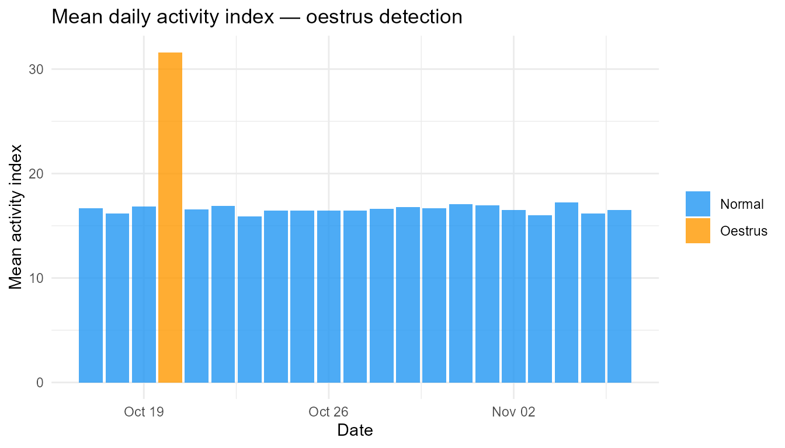

# Introduction to VirtualDairyHerdR


VirtualDairyHerdR generates biologically realistic synthetic dairy herd
data for teaching statistics, data wrangling, visualisation, and machine
learning in precision livestock farming contexts.

## The simulation pipeline

    simulate_farm()
        └── simulate_herd()
                ├── simulate_milk()
                │       ├── simulate_mastitis()
                │       └── simulate_fertility()
                ├── simulate_activity()
                └── simulate_bolus()           # high-frequency bolus sensor data

------------------------------------------------------------------------

## Step 1 — Build the herd

``` r

farm <- simulate_farm(name = "Greenfield Farm", n_cows = 200, seed = 42)
herd <- simulate_herd(farm = farm)
milk <- simulate_milk(herd, seed = 42)
health   <- simulate_mastitis(milk, prevalence = 0.15, seed = 42)
fert     <- simulate_fertility(milk, seed = 42)
activity <- simulate_activity(herd, seed = 42)
```

------------------------------------------------------------------------

## Visualisation

### Lactation curve — milk yield over DIM

Using `longitudinal = TRUE` to generate a full time series (one row per
cow per DIM), then plotting the Wood’s curve for a sample of cows.

``` r

herd_long <- simulate_herd(n_cows = 30, longitudinal = TRUE, seed = 42)
milk_long <- simulate_milk(herd_long, seed = 42)

# Sample 6 cows for clarity
sample_cows <- unique(milk_long$cow_id)[1:6]

milk_long |>
  dplyr::filter(cow_id %in% sample_cows) |>
  ggplot(aes(x = days_in_milk, y = milk_kg, colour = cow_id)) +
  geom_line(alpha = 0.8) +
  labs(
    title  = "Lactation curves — daily milk yield over DIM",
    x      = "Days in Milk",
    y      = "Milk yield (kg)",
    colour = "Cow ID"
  ) +
  theme_minimal() +
  theme(legend.position = "bottom")
```



### Breed-level lactation curves

``` r

milk_long |>
  ggplot(aes(x = days_in_milk, y = milk_kg, colour = breed, group = cow_id)) +
  geom_line(alpha = 0.3) +
  stat_smooth(aes(group = breed), se = FALSE, linewidth = 1.2) +
  labs(
    title  = "Lactation curves by breed",
    x      = "Days in Milk",
    y      = "Milk yield (kg)",
    colour = "Breed"
  ) +
  theme_minimal()
```



### SCC over DIM — healthy vs mastitis cows

``` r

health |>
  ggplot(aes(x = days_in_milk, y = log(scc), colour = mastitis)) +
  geom_point(alpha = 0.5, size = 1.5) +
  geom_smooth(se = FALSE) +
  scale_colour_manual(
    values = c("FALSE" = "#2196F3", "TRUE" = "#F44336"),
    labels = c("Healthy", "Mastitis")
  ) +
  labs(
    title  = "Log SCC over DIM — healthy vs mastitis cows",
    x      = "Days in Milk",
    y      = "log(SCC)",
    colour = NULL
  ) +
  theme_minimal()
```



### Effect of mastitis on milk yield

``` r

health |>
  ggplot(aes(x = mastitis, y = milk_kg, fill = mastitis)) +
  geom_boxplot(alpha = 0.7, outlier.alpha = 0.3) +
  scale_fill_manual(
    values = c("FALSE" = "#2196F3", "TRUE" = "#F44336"),
    labels = c("Healthy", "Mastitis")
  ) +
  scale_x_discrete(labels = c("Healthy", "Mastitis")) +
  labs(
    title = "Effect of mastitis on daily milk yield",
    x     = NULL,
    y     = "Milk yield (kg)"
  ) +
  theme_minimal() +
  theme(legend.position = "none")
```



### Mastitis effect on rumination and temperature

``` r

p1 <- ggplot(health, aes(x = mastitis, y = rumination_minutes, fill = mastitis)) +
  geom_boxplot(alpha = 0.7, outlier.alpha = 0.3) +
  scale_fill_manual(values = c("FALSE" = "#2196F3", "TRUE" = "#F44336")) +
  scale_x_discrete(labels = c("Healthy", "Mastitis")) +
  labs(title = "Rumination time", x = NULL, y = "Minutes") +
  theme_minimal() +
  theme(legend.position = "none")

p2 <- ggplot(health, aes(x = mastitis, y = temperature, fill = mastitis)) +
  geom_boxplot(alpha = 0.7, outlier.alpha = 0.3) +
  scale_fill_manual(values = c("FALSE" = "#2196F3", "TRUE" = "#F44336")) +
  scale_x_discrete(labels = c("Healthy", "Mastitis")) +
  labs(title = "Body temperature", x = NULL, y = "°C") +
  theme_minimal() +
  theme(legend.position = "none")

gridExtra::grid.arrange(p1, p2, ncol = 2)
```



### Activity score over DIM

``` r

activity |>
  ggplot(aes(x = days_in_milk, y = activity_score, colour = breed)) +
  geom_point(alpha = 0.4, size = 1.2) +
  geom_smooth(se = FALSE) +
  labs(
    title  = "Activity score over DIM by breed",
    x      = "Days in Milk",
    y      = "Activity score",
    colour = "Breed"
  ) +
  theme_minimal()
```



### Fertility — days open by lactation number

``` r

fert |>
  dplyr::filter(pregnant) |>
  ggplot(aes(x = factor(lactation), y = days_open, fill = factor(lactation))) +
  geom_boxplot(alpha = 0.7, outlier.alpha = 0.3) +
  labs(
    title = "Days open by lactation number (pregnant cows)",
    x     = "Lactation number",
    y     = "Days open"
  ) +
  theme_minimal() +
  theme(legend.position = "none")
```



------------------------------------------------------------------------

## Bolus sensor data

[`simulate_bolus()`](https://vincenttennanty.github.io/Farmaverse/reference/simulate_bolus.md)
generates high-frequency internal bolus sensor data mimicking platforms
such as SmaXtec. Each cow produces one row per timestamp at a
user-defined interval (default 10 minutes).

Biological patterns modelled: - **Temperature** — circadian rhythm (min
~05:00, max ~15:00), mastitis spike, oestrus rise - **Rumination** — two
daily peaks post-feeding (~08:00 and ~20:00), suppressed at oestrus and
mastitis - **Activity** — declines with DIM, strong oestrus spike over
12–18hrs, mastitis suppression

``` r

# 5 cows, 21 days, 10-minute intervals
bolus_herd <- simulate_herd(5, seed = 42)
bolus <- simulate_bolus(bolus_herd, days = 21, interval_mins = 10, seed = 42)
nrow(bolus)  # 5 cows x 21 days x 144 readings/day
#> [1] 15120
```

### Temperature — circadian rhythm and event spikes

Plotting a single cow to show the circadian pattern, with oestrus and
mastitis days highlighted.

``` r

cow1 <- bolus |> dplyr::filter(cow_id == unique(bolus$cow_id)[1])

# Daily mean temperature with event flags
cow1_daily <- cow1 |>
  dplyr::group_by(date, oestrus, mastitis) |>
  dplyr::summarise(mean_temp = mean(bolus_temp), .groups = "drop")

cow1 |>
  ggplot(aes(x = timestamp, y = bolus_temp)) +
  geom_line(alpha = 0.4, colour = "#607D8B") +
  geom_rect(
    data = dplyr::filter(cow1_daily, oestrus),
    aes(xmin = as.POSIXct(date), xmax = as.POSIXct(date) + 86400,
        ymin = -Inf, ymax = Inf),
    fill = "#FF9800", alpha = 0.2, inherit.aes = FALSE
  ) +
  geom_rect(
    data = dplyr::filter(cow1_daily, mastitis),
    aes(xmin = as.POSIXct(date), xmax = as.POSIXct(date) + 86400,
        ymin = -Inf, ymax = Inf),
    fill = "#F44336", alpha = 0.2, inherit.aes = FALSE
  ) +
  labs(
    title    = "Bolus temperature over time — one cow (21 days)",
    subtitle = "Orange = oestrus day  |  Red = mastitis day",
    x        = "Date",
    y        = "Internal temperature (°C)"
  ) +
  theme_minimal()
```



### Rumination — daily pattern and event suppression

``` r

cow1 |>
  dplyr::mutate(hour = as.numeric(format(timestamp, "%H")) +
                       as.numeric(format(timestamp, "%M")) / 60) |>
  dplyr::filter(date %in% unique(cow1$date)[1:3]) |>
  ggplot(aes(x = hour, y = rumination_mins,
             colour = factor(date), group = factor(date))) +
  geom_line(alpha = 0.8) +
  labs(
    title  = "Rumination pattern across 3 days — 10-minute intervals",
    x      = "Hour of day",
    y      = "Rumination (mins per interval)",
    colour = "Date"
  ) +
  theme_minimal()
```



### Activity — oestrus spike detection

The oestrus spike is the primary detection signal on real bolus
platforms.

``` r

cow1_daily_act <- cow1 |>
  dplyr::group_by(date, oestrus, mastitis) |>
  dplyr::summarise(mean_activity = mean(activity_index), .groups = "drop")

cow1_daily_act |>
  ggplot(aes(x = date, y = mean_activity,
             fill = oestrus)) +
  geom_col(alpha = 0.8) +
  scale_fill_manual(
    values = c("FALSE" = "#2196F3", "TRUE" = "#FF9800"),
    labels = c("Normal", "Oestrus")
  ) +
  labs(
    title  = "Mean daily activity index — oestrus detection",
    x      = "Date",
    y      = "Mean activity index",
    fill   = NULL
  ) +
  theme_minimal()
```



### Herd-level bolus summary

``` r

bolus |>
  dplyr::group_by(cow_id, oestrus, mastitis) |>
  dplyr::summarise(
    mean_temp       = round(mean(bolus_temp), 2),
    mean_rumination = round(mean(rumination_mins), 2),
    mean_activity   = round(mean(activity_index), 2),
    .groups = "drop"
  ) |>
  dplyr::arrange(cow_id)
#> # A tibble: 12 × 6
#>    cow_id  oestrus mastitis mean_temp mean_rumination mean_activity
#>    <chr>   <lgl>   <lgl>        <dbl>           <dbl>         <dbl>
#>  1 COW0001 FALSE   FALSE         38.8            1.81         16.6 
#>  2 COW0001 TRUE    FALSE         39.3            0.15         31.6 
#>  3 COW0002 FALSE   FALSE         38.5            2.2          19.3 
#>  4 COW0002 FALSE   TRUE          40.5            1.05         14.8 
#>  5 COW0002 TRUE    FALSE         39.2            0.43         42.2 
#>  6 COW0003 FALSE   FALSE         38.6            2.13         19.0 
#>  7 COW0003 TRUE    FALSE         38.8            0.19         33.9 
#>  8 COW0004 FALSE   FALSE         38.7            2            13.3 
#>  9 COW0004 FALSE   TRUE          40.1            1.36          8.53
#> 10 COW0004 TRUE    FALSE         39.2            0.3          25.8 
#> 11 COW0005 FALSE   FALSE         38.5            1.97         18.0 
#> 12 COW0005 TRUE    FALSE         39.2            0.36         30.3
```

------------------------------------------------------------------------

## Mixed models with lme4

Using [`lme4::lmer()`](https://rdrr.io/pkg/lme4/man/lmer.html) to
account for the repeated-measures structure of the longitudinal data.
Each model includes a random intercept for `cow_id`.

``` r

library(lme4)
milk_long_full <- simulate_milk(herd_long, seed = 42)
health_long    <- simulate_mastitis(milk_long_full, prevalence = 0.15, seed = 42)
fert_long      <- simulate_fertility(milk_long_full, seed = 42)
```

### Model 1 — Milk yield ~ DIM + breed + lactation

Does breed and parity explain variation in milk yield after accounting
for stage of lactation?

``` r

m1 <- lmer(milk_kg ~ days_in_milk + breed + lactation + (1 | cow_id),
           data = milk_long_full)
summary(m1)
#> Linear mixed model fit by REML ['lmerMod']
#> Formula: milk_kg ~ days_in_milk + breed + lactation + (1 | cow_id)
#>    Data: milk_long_full
#> 
#> REML criterion at convergence: 61466.5
#> 
#> Scaled residuals: 
#>     Min      1Q  Median      3Q     Max 
#> -4.3708 -0.6705 -0.0291  0.6323  4.3279 
#> 
#> Random effects:
#>  Groups   Name        Variance Std.Dev.
#>  cow_id   (Intercept)  0.4199  0.648   
#>  Residual             48.1459  6.939   
#> Number of obs: 9150, groups:  cow_id, 30
#> 
#> Fixed effects:
#>                 Estimate Std. Error t value
#> (Intercept)   38.0154321  0.5041004  75.412
#> days_in_milk  -0.0328224  0.0008239 -39.839
#> breedFriesian  3.2668361  0.4654685   7.018
#> breedHolstein  3.1201598  0.4320716   7.221
#> breedJersey   -5.7261529  0.5588631 -10.246
#> lactation     -0.8030836  0.0874992  -9.178
#> 
#> Correlation of Fixed Effects:
#>             (Intr) dys_n_ brdFrs brdHls brdJrs
#> days_in_mlk -0.250                            
#> breedFriesn -0.616  0.000                     
#> breedHolstn -0.707  0.000  0.718              
#> breedJersey -0.346  0.000  0.555  0.578       
#> lactation   -0.608  0.000  0.000  0.072 -0.274
```

### Model 2 — log(SCC) ~ mastitis + DIM

Does mastitis status explain SCC after accounting for DIM?

``` r

m2 <- lmer(log(scc) ~ mastitis + days_in_milk + (1 | cow_id),
           data = health_long)
summary(m2)
#> Linear mixed model fit by REML ['lmerMod']
#> Formula: log(scc) ~ mastitis + days_in_milk + (1 | cow_id)
#>    Data: health_long
#> 
#> REML criterion at convergence: 14067.8
#> 
#> Scaled residuals: 
#>     Min      1Q  Median      3Q     Max 
#> -4.2192 -0.6580  0.0080  0.6833  3.4692 
#> 
#> Random effects:
#>  Groups   Name        Variance  Std.Dev.
#>  cow_id   (Intercept) 3.735e-05 0.006111
#>  Residual             2.715e-01 0.521058
#> Number of obs: 9150, groups:  cow_id, 30
#> 
#> Fixed effects:
#>               Estimate Std. Error t value
#> (Intercept)  4.512e+00  1.122e-02   402.2
#> mastitisTRUE 2.458e+00  1.500e-02   163.8
#> days_in_milk 1.918e-03  6.187e-05    31.0
#> 
#> Correlation of Fixed Effects:
#>             (Intr) msTRUE
#> mastitsTRUE -0.206       
#> days_in_mlk -0.843 -0.004
```

### Model 3 — Days open ~ milk yield + lactation

Does higher milk yield delay conception (the production–fertility
antagonism)?

``` r

m3 <- lmer(days_open ~ milk_kg + lactation + (1 | cow_id),
           data = dplyr::filter(fert_long, pregnant))
summary(m3)
#> Linear mixed model fit by REML ['lmerMod']
#> Formula: days_open ~ milk_kg + lactation + (1 | cow_id)
#>    Data: dplyr::filter(fert_long, pregnant)
#> 
#> REML criterion at convergence: 36944.4
#> 
#> Scaled residuals: 
#>     Min      1Q  Median      3Q     Max 
#> -1.5748 -0.7762 -0.2727  0.5183  3.3428 
#> 
#> Random effects:
#>  Groups   Name        Variance Std.Dev.
#>  cow_id   (Intercept)   7.612   2.759  
#>  Residual             451.069  21.238  
#> Number of obs: 4124, groups:  cow_id, 30
#> 
#> Fixed effects:
#>             Estimate Std. Error t value
#> (Intercept) 47.96332    2.12656  22.554
#> milk_kg      0.64550    0.04381  14.733
#> lactation    0.79396    0.35721   2.223
#> 
#> Correlation of Fixed Effects:
#>           (Intr) mlk_kg
#> milk_kg   -0.765       
#> lactation -0.707  0.182
```

------------------------------------------------------------------------

## Summarising with `education_summary()`

``` r

education_summary(fert, by = "breed")
#> # A tibble: 4 × 10
#>   breed    n_cows mean_dim mean_milk_kg sd_milk_kg mean_fat_pct mean_protein_pct
#>   <chr>     <int>    <dbl>        <dbl>      <dbl>        <dbl>            <dbl>
#> 1 Jersey       24     153.         23.8       6.36         3.83             3.22
#> 2 Friesian     54     135.         34.5       8.39         3.55             3.04
#> 3 Holstein     99     163.         33.1       6.44         3.55             3.05
#> 4 Crossbr…     23     141.         30.5       5.39         3.52             3.1 
#> # ℹ 3 more variables: mean_scc <dbl>, conception_rate <dbl>,
#> #   mean_days_open <dbl>
```

``` r

education_summary(fert, by = "lactation")
#> # A tibble: 6 × 10
#>   lactation n_cows mean_dim mean_milk_kg sd_milk_kg mean_fat_pct
#>       <int>  <int>    <dbl>        <dbl>      <dbl>        <dbl>
#> 1         5     20     142.         30.4       8.11         3.54
#> 2         6     18     165.         29.9       6.85         3.57
#> 3         2     37     175.         30.8       8.08         3.68
#> 4         3     37     131.         33.4       6.73         3.56
#> 5         4     39     150.         31.8       8.84         3.57
#> 6         1     49     150.         33.7       6.6          3.55
#> # ℹ 4 more variables: mean_protein_pct <dbl>, mean_scc <dbl>,
#> #   conception_rate <dbl>, mean_days_open <dbl>
```

------------------------------------------------------------------------

## Reproducibility

``` r

a <- simulate_milk(simulate_herd(50, seed = 1), seed = 1)
b <- simulate_milk(simulate_herd(50, seed = 1), seed = 1)
identical(a, b)
#> [1] TRUE
```
